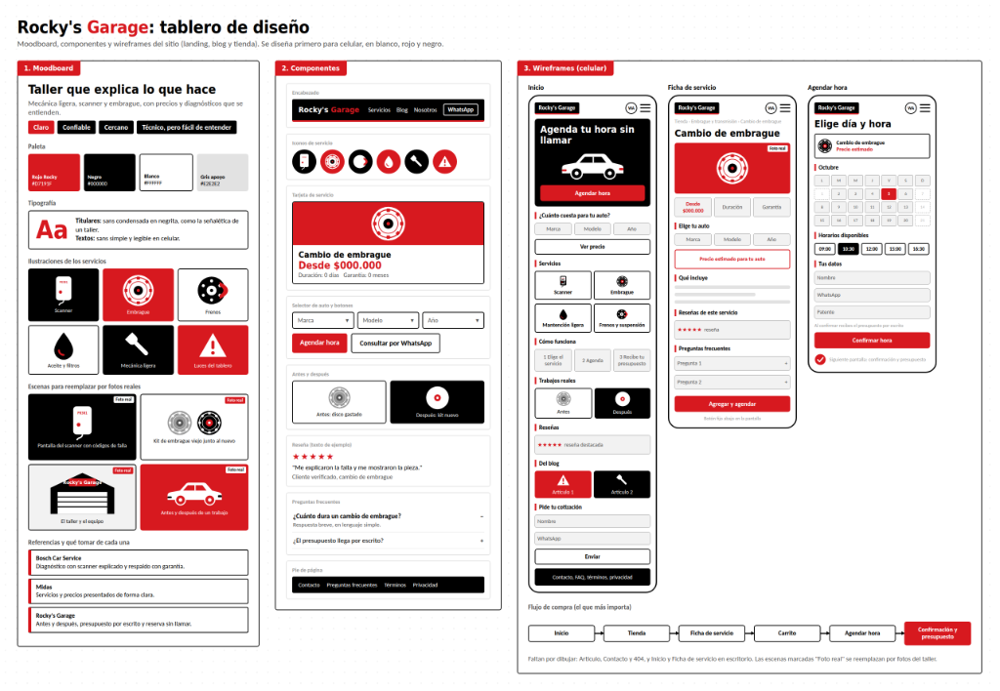

# Moodboard — Rocky's Garage

> Guía: [Moodboard](../evaluacion/guias/fase-2-specs/02-moodboard.md)

**Tablero en Whimsical:** [pega aquí el link de tu tablero en Whimsical]

## Palabras clave

Claro · Confiable · Cercano · Técnico, pero fácil de entender

## Qué sensación buscamos

Queremos que Rocky's Garage transmita la sensación de un taller moderno, directo y transparente: un espacio limpio y profesional donde el cliente entiende exactamente qué falla tiene su auto y cuánto le costará repararla, sin tecnicismos oscuros ni sorpresas en la cuenta final. Para Felipe, que depende de su vehículo todos los días para trabajar y teme que le inventen fallas o le cobren de más, este estilo visual (basado en contraste negro, blanco y rojo, tipografía técnica legible y fotos reales de repuestos y scanners) le otorga confianza inmediata, control sobre el presupuesto y la seguridad de dejar su auto en un taller serio.

